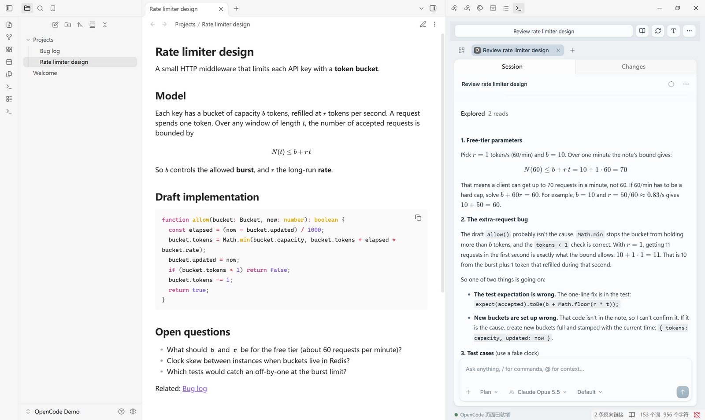
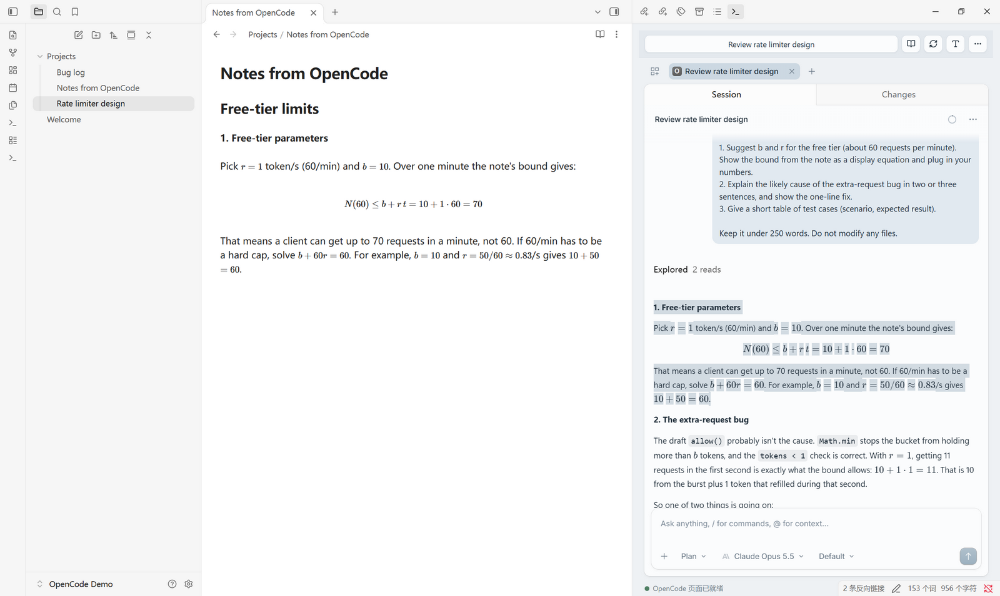
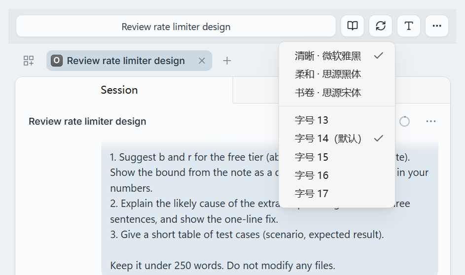
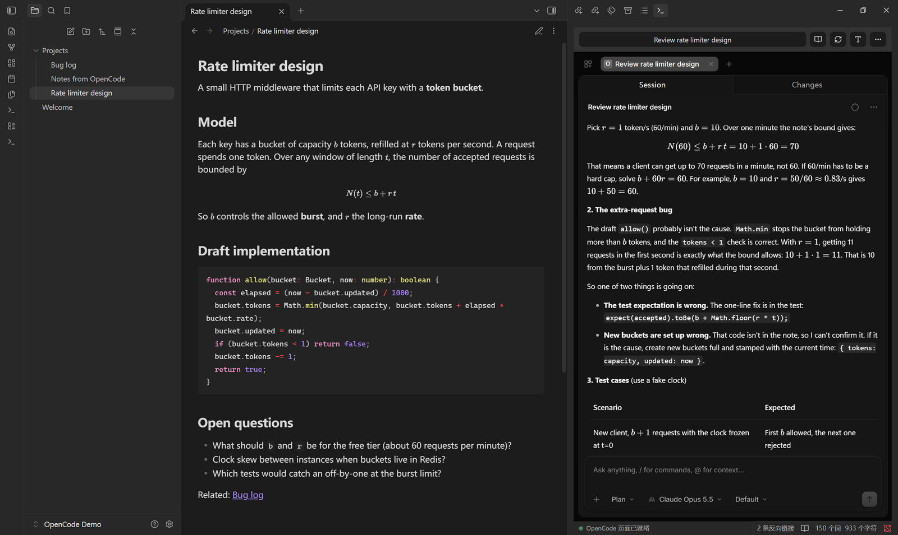

# OpenCode Web Sidebar

Use [OpenCode Web](https://opencode.ai/) next to your notes in Obsidian desktop.
This is an unofficial plugin, not affiliated with Obsidian or OpenCode.
It embeds OpenCode's web interface; it is not a terminal emulator, and is a different
plugin from "OpenCode CLI Sidebar".

[中文说明](README.zh-CN.md)



## Screenshots

**Copy a reply, paste it into a note.** Formulas are copied as Markdown source
(`$...$` and `$$...$$`), so they render in the editor instead of becoming KaTeX text.



**Pick the reading font and size** from the **Aa** button in the toolbar.



**Dark mode** keeps OpenCode's native colors; the plugin shell follows your Obsidian theme.



## Features

- Embed the native OpenCode Web UI in a sidebar.
- Configure a separate server URL and project directory for each vault.
- Connect to local or remote HTTP/HTTPS servers, with optional Basic Auth.
- Search sessions using an optional directory path on the server.
- Use a compact Nordic-blue Chinese toolbar and an optional local Windows TUI launcher.
- Choose the reading font and size for replies; bold text and single line breaks display clearly.
- Open the current session in a separate reader web page. The reader URL defaults
  to `http://127.0.0.1:18924` and can be changed in each vault's settings.
- Render missing inline/block math with bundled KaTeX; no extra local service required.
- Copy selected replies as Markdown, restoring formulas to `$...$` and `$$...$$`.
- Isolate live webview sessions across vaults and windows; recover when an offline server returns.

The plugin does **not** launch the OpenCode Web server, read its database, generate
conversation snapshots, or start a reader service. Clicking **Open OpenCode TUI**
explicitly runs a local, trusted Windows `.bat`/`.cmd` launcher. The optional reading button
requires a separate, compatible reader service; embedded chat does not.

## Install

This plugin is not yet in the Obsidian community plugin directory. Installing it
does not install or start an OpenCode server.

### BRAT (convenient for multiple vaults)

Install and enable the [BRAT](https://github.com/TfTHacker/obsidian42-brat) community
plugin in a vault, then add this GitHub repository as a beta plugin:

`Hatsunemiku533/opencode-web-sidebar`

Repeat the installation in each vault. BRAT can update it from GitHub releases;
settings stay local to the vault. There is no global Obsidian plugin installation.

### Manual

Download `main.js`, `manifest.json`, and `styles.css` from
[Releases](https://github.com/Hatsunemiku533/opencode-web-sidebar/releases).
Put them in `<vault>/.obsidian/plugins/opencode-web-sidebar/`, reload Obsidian, then
enable OpenCode Web Sidebar in **Settings > Community plugins**.

### Upgrading from 1.2.x

Version 1.3.0 renamed the plugin (id `opencode-sidebar` became `opencode-web-sidebar`)
because the old id was already taken in the community directory. Obsidian treats it as
a new plugin: install it as above, enable it, then copy your old
`.obsidian/plugins/opencode-sidebar/data.json` into the new plugin folder to keep your
settings. Remove the old folder afterwards.

## Configure

1. Start your OpenCode Web server separately (for example, `opencode web --port 4096`).
2. Set **OpenCode Web URL** to its base URL; the default is `http://127.0.0.1:4096`.
3. Leave **Basic Auth** off for a server without HTTP authentication. For an
   authenticated server, enable it and enter its username and password.
4. Optionally set **Project directory** to an absolute path **on the server**.
   For a local service it can be your vault path. For a remote service, do not use
   your local vault path unless the server uses that exact same path.
5. Use **Apply and reconnect**, then the terminal ribbon icon or **OpenCode
   Sidebar: Open sidebar** command.

The project directory filters the toolbar's **选择会话 (Choose session)** picker,
not the native web UI's home list. That home list only shows directories opened
as web projects. If your active sessions live in a subdirectory, choose them
from the toolbar or open that subdirectory as a project in the native web UI.
The toolbar title follows session navigation in the native web page. Leaving
the directory blank lists all sessions returned by the server.

On Windows, **More > 打开 OpenCode TUI** uses `启动opencode-TUI.bat` from the configured
local project directory when present. For another location or a remote Web
server, set **TUI 启动脚本** to a trusted local `.bat`/`.cmd` absolute path. It
does not install or launch OpenCode Web. Do not point it to an untrusted script.
The plugin shell uses a muted Nordic blue-gray palette. **北欧蓝网页外观** (enabled
by default) adds a removable light-mode color overlay, medium rounded corners and
gentle transitions (skipped when the system asks for reduced motion) to the
embedded app only. Toggling it restores the native look immediately without
reloading or discarding drafts. Native dark-mode colors, layout, syntax colors
and diff themes remain unchanged.
The toolbar **Aa** button, or **正文字体** / **正文字号** in settings, picks the
message font (Microsoft YaHei by default, Noto Sans SC, or Noto Serif SC; locally
installed fonts only) and size (13–17px, default 14px). Regardless of the color
toggle, bold text uses a visibly heavier weight and a single newline inside a
paragraph is shown as a line break, like Obsidian; copied Markdown is unchanged.
It does not affect other browser windows, mobile clients or home session filters.

URLs with embedded credentials, queries, fragments, or unsupported schemes are
rejected. A reverse-proxy subpath is accepted, but your OpenCode/proxy deployment
must also serve its assets and routing correctly at that path.

### Remember Projects

**记住项目目录 (Remember project directories)** is on by default. Each vault remembers
the native page's open projects, expansion state and last homepage selection.
These are restored at document start on reload/recreation without navigating to
an old session or replacing the toolbar picker's configured directory.
After enabling, add/select your project once in the native page; later changes
are saved automatically. Closing a project updates the memory rather than
reopening it next time. Turning the option off clears the saved directory state
and stops capture; the next recreated view starts with an empty project list.
It does not immediately reload the current page or delete server-side data.

Memory is isolated by full vault path, server URL and authentication identity.
Changing these starts a separate identity rather than restoring another server's
paths. In multiple windows for one vault, the last saved project-selection change
wins; unrelated settings saves preserve the latest stored project memory.
Only directory paths and selection metadata are saved, never native server
credentials, session tabs or drafts. Paths live in `data.json`; keep this local.
Startup uses a guest page script registered before navigation, not a webview
preload (which Obsidian removes). Restoration is checked before capture starts;
failure preserves the saved memory and shows a diagnostic warning. The temporary
debugger attachment is released after the startup check or view disposal.
Up to 50 projects are retained, prioritizing the selected and most recent project.
The adapter targets OpenCode Web 1.18.18's native storage format; upstream changes
may require an update.

## Disclosures

- **Network:** the plugin connects only to the OpenCode Web URL you configure, and
  (when you click the reader button) opens the reader URL in your browser. The
  default reader URL is `http://127.0.0.1:18924`, a local address. No telemetry.
- **Files written:** per-vault diagnostic logs in `<system temp>/opencode-sidebar/`
  (on Windows, `%TEMP%\opencode-sidebar\`), and the plugin's own `data.json`.
- **Local program execution:** only when you click **Open OpenCode TUI**, the plugin
  runs the `.bat`/`.cmd` launcher you configured. Use scripts you trust.
- **Credentials:** the optional Basic Auth password is stored in plaintext in `data.json`.
- **Desktop only:** it uses Electron's webview, so it does not work on mobile.
- **No `innerHTML`:** math is rendered with bundled KaTeX and inserted through `DOMParser`.

## Security And Privacy

- **Basic Auth passwords are stored in plaintext** in the plugin's `data.json`.
  Masking the settings field does not encrypt it. Exclude that file from Git,
  public backups and untrusted synchronization.
- Use **HTTPS for remote servers**. HTTP Basic Auth is only Base64 encoding, not encryption.
- Credentials are attached only to the configured origin and path, never to a
  credential-bearing URL. API requests do not automatically follow redirects.
- OpenCode is an agent that may access files and run tools on its server. Connect
  only to trusted services and review OpenCode's own permissions.
- There is no analytics, telemetry, or extra backend. The plugin connects to your
  configured server; the native web application controls its own network traffic.
- Diagnostics omit conversation bodies, URLs and credential values.
- Each webview uses a private, non-persistent Electron session to avoid
  authentication-hook conflicts. Project directories can be remembered separately
  using the option above. Other web UI local preferences and unsent drafts do not
  survive closing/recreating the view. Saved conversations remain on the server.

Settings are keyed by the full vault path, not just its name, so same-named vaults
do not collide. Moving a vault to a different path requires configuring it again.
Settings writes use a short file lock to merge safely across windows. If Obsidian
crashes during a save and reports a stale lock later, close all windows using the
plugin and remove only `data.json.lock` from the plugin folder, then reopen it.

## Reader Button

The book icon opens `<reader URL>/read/<session ID>` in a separate browser window,
using the session currently displayed in the native web UI. If no session is open,
the plugin asks you to choose one from the project session list.

The default reader address matches the original local setup:
`http://127.0.0.1:18924`. Change **阅读服务地址 (Reader service URL)** in the plugin
settings to use another deployment. This is **not** a built-in OpenCode endpoint;
the reader must already be running and able to read the same conversations.
The plugin does not install it or send OpenCode Basic Auth credentials to it.
A stopped reader does not prevent embedded chat from working. No snapshot
generation or overwrite feature is restored.

## Math Copy

With math fixes enabled, select text inside a rendered reply and use normal Copy.
The selection is serialized to plain Markdown, not KaTeX HTML. Paragraph breaks,
common lists, links, emphasis, code and ordinary tables are retained. Tables include
header separators, column alignment, escaped pipes and `<br>` cell line breaks.
Cross-cell selections remain tables with only selected text; body-only selections
use an empty header, and single-cell selections stay plain inline content.
This is not a full Markdown round-trip exporter (merged cells, nested tables and
deeply nested structures may need editing).

A selection touching part of a formula copies the **complete formula once**.
Editor/input copying is left alone. OpenCode's own message-copy button may bypass
the selection handler and use its original source instead.

## Troubleshooting

- **Blank view / HTTP 401:** check the URL and Basic Auth settings, then Apply.
  Credentials in URLs are deliberately unsupported.
- **Offline:** start the server separately; the view retries an offline service
  every ten seconds. Wrong credentials are not retried indefinitely.
- **Changed settings:** Apply reconnects with new credentials and may discard an unsent draft.
- **After a manual plugin update:** toggle the plugin off/on or restart Obsidian.
- Use **More > 诊断嵌入页 (Diagnose embedded page)** to collect API health and page
  evidence separately. It reports likely next checks, not a proven root cause.
- **复制调试日志 (Copy debug log)** refreshes the diagnostic snapshot and copies
  recent persisted history, including earlier connections. **打开日志文件 (Open
  log file)** opens the actual file. **打开嵌入页开发者工具 (Open webview developer
  tools)** is available for errors the privacy-safe summary cannot fully explain.

### Diagnostic Evidence

Logs include plugin/build ID, Obsidian/Electron/Chromium versions, a connection ID
and relative timing, authentication mode, main-document HTTP status, failures of
scripts/styles, sanitized script filenames and stack locations, DOM root counts,
panel dimensions, and math/copy-hook status. API health alone is never used to
claim the page is ready. Console/runtime hooks work even with math fixes disabled.

Known errors are classified (context provider, credential URL, fetch, lazy chunk,
CSP, and missing session). Arbitrary exception messages, raw HTML, chat text,
request/response bodies, headers, full URLs and session IDs are not stored.
ResizeObserver noise and repeated runtime signals are suppressed.

Failures and manual reconnects automatically preserve a page snapshot **before**
the view is replaced. Diagnosis never restarts the page or clears cache. A slow
page inspection is bounded to four seconds; API checks have their own timeout.

Per-vault logs are stored in `<system temporary directory>/opencode-sidebar/`,
with a hashed filename. On Windows this is normally under `%TEMP%`. The active
file rotates at about 512 KiB and retains one previous file. A disk failure falls
back to in-memory diagnostics, merged into copied disk history without losing
the failure-period records. Rotation is protected by a cross-window lock. If a
crash leaves a stale `<log filename>.rotation.lock`, close the windows using that
vault and remove only that lock file; do not delete the log itself.
Runtime error hints expire after a minute; a recovered page is not permanently
classified as failed because of an earlier transient error.
OS temporary-file cleanup can remove the logs;
these are not permanent backups. Two windows editing the same vault can write
to the same log, so use connection IDs to correlate events. Diagnostic files are
local only, but still review them before sharing; never paste private settings
or an unreviewed DevTools/network capture into a public issue.

## Compatibility

Desktop only, using Electron webview and its authentication APIs. Initial checks
use Obsidian 1.12.7 on Windows and OpenCode Web 1.18.17. Other platforms and
OpenCode versions have not yet been tested. Changes in upstream DOM, session
routes or APIs may require an update. The manifest's minimum API baseline is
1.5.0, not a claim of a full test matrix.

## Development

Node.js 22.12+ and npm:

```sh
npm ci
npm run check
```

Source lives in `src/`. `npm run build` bundles the plugin, page fixes and KaTeX
resources into root `main.js`, so installed users need no Node/npm or font folder.
Tests cover DOM selections, math delimiters, clipboard MIME data, URL validation,
auth isolation, API behavior and per-vault settings. Release assets are the three
Obsidian files plus license notices. Do not commit `data.json` or local notes.

## License

[MIT](LICENSE). Bundled KaTeX is also MIT; see [third-party notices](THIRD_PARTY_LICENSES.md).
